# EXPENSEPULSE: Real-Time Multi-Tier Financial Analytics, Budget Optimization & Automated Expense Tracking System

---

## A PROJECT REPORT
*Submitted in partial fulfillment of the requirements for the degree of*  
**BACHELOR OF TECHNOLOGY in COMPUTER SCIENCE AND ENGINEERING**

### Academic Session: 2026 – 2027
**DEPARTMENT OF COMPUTER SCIENCE & ENGINEERING**  
**SUBJECT:** Software Engineering  
**PROJECT GROUP:** Financial Informatics Engineering Group  

---

## DECLARATION
We hereby declare that the software engineering project work entitled **"ExpensePulse: Real-Time Multi-Tier Financial Analytics, Budget Optimization & Automated Expense Tracking System"** is an authentic and original work developed under the supervision of our project mentor.

We declare that all architectural models, Unified Modeling Language (UML) diagrams, Data Flow Diagrams (DFDs), Entity-Relationship (ER) schemas, algorithmic implementations (Greedy Debt Minimization, Exponential Moving Average Cashflow Forecasting, Category Heuristic Matching), test matrices, and technical descriptions documented herein represent the authentic operational mechanics of the application codebase. All external open-source libraries, frameworks (React, Vite, TailwindCSS, Lucide-react, Canvas-Confetti), and financial data standards have been duly recognized, referenced, and cited in the bibliography.

---

## ACKNOWLEDGEMENTS
The successful conceptualization, architectural design, software development, and documentation of **ExpensePulse** have been made possible through the collective guidance, encouragement, and support of numerous individuals and institutions.

First and foremost, we express our profound gratitude to our project guide and mentor for intellectual guidance, constructive critique, and continuous technical advice throughout the software development lifecycle. Their rigorous scrutiny of system architecture, financial precision rules, data flow diagrams, and edge-case handling significantly elevated the robustness of this application.

We are deeply indebted to the Head of the Department of Computer Science & Engineering and faculty members for providing state-of-the-art computational infrastructure, modern laboratory facilities, and an intellectually stimulating academic atmosphere conducive to cutting-edge software engineering.

We also extend our sincere appreciation to personal financial advisors, fintech engineers, and everyday household budgeters whose practical feedback on cashflow management, expense leakage, and peer-to-peer bill splitting helped shape the core features of the ExpensePulse platform.

---

## ABSTRACT
In modern consumer economics, individuals and households face acute challenges in maintaining financial health due to fragmented transaction channels, unmonitored recurring digital subscriptions, lack of category-level budget discipline, and cumbersome debt reconciliation among peers. Conventional expense tracking systems frequently suffer from high manual logging friction, complex setup overhead, invasive privacy requirements (such as demanding permanent third-party bank credentials), and the absence of predictive velocity warnings before budget limits are catastrophically breached.

**ExpensePulse** is an intelligent, reactive, web-based software platform engineered to eliminate personal financial blind spots and optimize budget allocation through a **Tripartite Financial Synergy Bridge** connecting:
1. **The Individual Budgeter & Household Planner** (Real-time income/expense tracking, category allocations, and velocity warnings),
2. **The Peer-to-Peer Shared Expense Group** (Multi-member bill splitting and algorithmic debt graph simplification), and
3. **The Automated Cashflow Forecast Engine** (Algorithmic trend projection, recurring subscription management, and health scoring).

Engineered using **React, Vite, TailwindCSS, Web Audio API, and Client-Side Persistent Storage**, ExpensePulse integrates eight mission-critical functional modules into a single, cohesive, high-performance Single Page Application (SPA):
* **Real-Time Financial Intake & Transaction Hub**: Captures multi-currency income and expense entries with sub-millisecond reactive ledger updating.
* **Smart Dynamic Category & Tag Allocation Engine**: Categorizes transactions across primary and secondary spending buckets with automated heuristic suggestion.
* **Multi-Tier Budget Monitoring & Velocity Burn Tracker**: Evaluates daily spending velocity against defined period thresholds with visual badges (`SAFE`, `MODERATE`, `WARNING`, `EXCEEDED`).
* **Algorithmic Peer-to-Peer Debt Simplification Engine**: Employs a bipartite flow / greedy net-balance graph reduction algorithm to compress $N$-way group debts into minimum directional settlements.
* **Recurring Subscription & Bill Amortization Radar**: Catalogs recurring fixed overheads with countdown timers and automated cashflow debit forecasting.
* **Acoustic-Visual Overspending Distress Siren**: Leverages the browser's native Web Audio API oscillator to synthesize real-time auditory caution tones upon budget limit violations.
* **Net Worth & Multi-Account Liquidity Dashboard**: Monitors aggregate balances across cash, bank checking, savings, and credit ledgers with zero-latency reconciliation.
* **Export & Financial Audit Trail Generator**: Enables instant client-side generation of cryptographically timestamped CSV and JSON audit ledgers.

---

## TABLE OF CONTENTS
1. [CHAPTER 1: INTRODUCTION & PROJECT FOUNDATION](#chapter-1-introduction--project-foundation)
   - 1.1 Problem Specification & Real-World Economic Context
   - 1.2 Motivation & Societal Impact of Financial Illiteracy and Budget Leakage
   - 1.3 Project Objectives & Defined Scope
   - 1.4 Target Audience & Stakeholder Matrix
   - 1.5 Hardware & Software Environment Specifications
2. [CHAPTER 2: LITERATURE SURVEY & FEASIBILITY STUDY](#chapter-2-literature-survey--feasibility-study)
   - 2.1 Survey of Existing Personal Finance & Expense Management Platforms
   - 2.2 Shortcomings of Conventional Platforms
   - 2.3 Proposed ExpensePulse Paradigm
   - 2.4 Comparative Feature Analysis Matrix
   - 2.5 Multi-Dimensional Feasibility Study
3. [CHAPTER 3: SOFTWARE REQUIREMENTS SPECIFICATION (SRS)](#chapter-3-software-requirements-specification-srs)
   - 3.1 Overall System Description & Operational Context
   - 3.2 Detailed Functional Requirements (FR-01 to FR-20)
   - 3.3 Non-Functional Requirements (NFR-01 to NFR-10)
   - 3.4 Data Requirements & Comprehensive Data Dictionary
4. [CHAPTER 4: SYSTEM DESIGN & VISUAL MODELING](#chapter-4-system-design--visual-modeling)
   - 4.1 High-Level System Architecture & Layered Tier Decomposition
   - 4.2 Data Flow Diagrams (DFDs: Level 0, Level 1, Level 2, Level 3)
   - 4.3 User Flow & Activity Diagrams
   - 4.4 Entity-Relationship (ER) Modeling & Conceptual Schema
   - 4.5 Unified Modeling Language (UML) Behavioral & Structural Models
5. [CHAPTER 5: ARCHITECTURAL MODULES & FEATURE DEEP-DIVE](#chapter-5-architectural-modules--feature-deep-dive)
   - 5.1 Real-Time Transaction Intake & Smart Tagging
   - 5.2 Dynamic Budget Allocation & Velocity Burn Engine
   - 5.3 Algorithmic P2P Group Debt Simplification
   - 5.4 Multi-Account Liquidity & Net Worth Ledger
   - 5.5 Recurring Subscription Radar & Cashflow Calendar
   - 5.6 Web Audio API Acoustic Distress Siren Engine
   - 5.7 Financial Health Scoring & Gamified Milestone Badging
6. [CHAPTER 6: IMPLEMENTATION & CRUCIAL CODE SNIPPETS](#chapter-6-implementation--crucial-code-snippets)
   - 6.1 Algorithmic Debt Minimization (Greedy Flow Algorithm)
   - 6.2 Cashflow Projection Engine (Exponential Moving Average)
   - 6.3 Budget Burn Rate & Velocity Overrun Evaluation
   - 6.4 Web Audio API Audio Synthesizer Warning Generator
   - 6.5 Reactive Persistent LocalStorage Hydration Pipeline
7. [CHAPTER 7: SOFTWARE TESTING & QUALITY ASSURANCE](#chapter-7-software-testing--quality-assurance)
   - 7.1 Testing Philosophy, Methodology & V-Model Framework
   - 7.2 Unit Testing Strategies & Modular Boundaries
   - 7.3 Integration Testing
   - 7.4 Exhaustive Test Case Tables (TC-01 through TC-25)
   - 7.5 Security, Financial Precision & Privacy Testing
8. [CHAPTER 8: USER INTERFACE & SCREENSHOT CATALOGUE](#chapter-8-user-interface--screenshot-catalogue)
   - 8.1 UI/UX Design System, Typography & Color Semantics
   - 8.2 Comprehensive View & Screen Specifications
9. [CHAPTER 9: REAL-WORLD APPLICATIONS & SOCIETAL DEPLOYMENT](#chapter-9-real-world-applications--societal-deployment)
   - 9.1 Student & Individual Budgeting
   - 9.2 Freelancer & Gig Economy Cashflow Tracking
   - 9.3 Shared Flat / Roommate Living Expense Settlement
   - 9.4 Cloud Deployment Architecture & PWA Readiness
10. [CHAPTER 10: LIMITATIONS & FUTURE ENHANCEMENTS](#chapter-10-limitations--future-enhancements)
    - 10.1 Technical & Operational Limitations
    - 10.2 Future Roadmap (Phase 2 & Phase 3)
11. [CHAPTER 11: CONCLUSION](#chapter-11-conclusion)
    - 11.1 Project Summary
    - 11.2 Key Learnings & Engineering Takeaways
    - 11.3 Concluding Remarks
12. [CHAPTER 12: REFERENCES & BIBLIOGRAPHY](#chapter-12-references--bibliography)
13. [APPENDICES](#appendices)
    - Appendix A: Acronyms & Glossary of Terms
    - Appendix B: Financial Precision, Double-Entry Principles & Floating-Point Mitigation
    - Appendix C: Mathematical Derivations of Debt Simplification & Smoothing

---

## LIST OF FIGURES
| Figure Number | Description | Section Reference |
| :--- | :--- | :--- |
| **Figure 4.1** | ExpensePulse High-Level Tiered System Architecture | Section 4.1 |
| **Figure 4.2** | Level 0 Data Flow Diagram (Context-Level DFD) | Section 4.2.1 |
| **Figure 4.3** | Level 1 Data Flow Diagram (Subsystem Macro Data Flow) | Section 4.2.2 |
| **Figure 4.4a**| Level 2 DFD - Subsystem 2.1: Transaction Intake & Category Heuristics | Section 4.2.3 |
| **Figure 4.4b**| Level 2 DFD - Subsystem 2.2: Budget Velocity & Overrun Evaluation | Section 4.2.3 |
| **Figure 4.4c**| Level 2 DFD - Subsystem 2.3: Algorithmic Group Debt Simplification | Section 4.2.3 |
| **Figure 4.5** | Level 3 DFD (Micro-Level Transaction Balancing & Audit Pipeline) | Section 4.2.4 |
| **Figure 4.6** | Expense Entry & Smart Validation User Flow Diagram | Section 4.3.1 |
| **Figure 4.7** | Period Budget Setup & Real-Time Velocity Warning Flow | Section 4.3.2 |
| **Figure 4.8** | Group Bill Split & Greedy Debt Settlement Flow | Section 4.3.3 |
| **Figure 4.9** | Recurring Subscription Tracking & Cashflow Projection Flow | Section 4.3.4 |
| **Figure 4.10**| Acoustic Over-Budget SOS Audio Distress Flow | Section 4.3.5 |
| **Figure 4.11**| Entity-Relationship (ER) Conceptual Schema Diagram | Section 4.4 |
| **Figure 4.12**| Comprehensive System Use Case Diagram | Section 4.5.1 |
| **Figure 4.13**| Sequence Diagram: Transaction Logging, Budget Breaching & Alert Dispatch | Section 4.5.2 |
| **Figure 4.14**| State Transition Diagram: Transaction & Budget Lifecycle State Machine | Section 4.5.3 |
| **Figure 4.15**| System Component & Package Architecture Diagram | Section 4.5.4 |
| **Figure 6.1** | Debt Minimization Directed Graph Flow Transformation | Section 6.1 |
| **Figure 6.2** | Dual-Tone Warning Synthesizer Frequency Sweep Profile | Section 6.4 |

---

## LIST OF TABLES
| Table Number | Description | Section Reference |
| :--- | :--- | :--- |
| **Table 1.1** | Development & Host Computational Environment | Section 1.5.1 |
| **Table 1.2** | Client-Side Browser Matrix & Hardware Footprint | Section 1.5.2 |
| **Table 1.3** | Production Dependencies & Library Toolchain | Section 1.5.3 |
| **Table 2.1** | Comparative Feature Matrix: ExpensePulse vs Traditional Financial Tools | Section 2.4 |
| **Table 3.1** | Comprehensive Functional Requirements Specification (FR-01 to FR-20) | Section 3.2 |
| **Table 3.2** | Non-Functional Requirements Specification (NFR-01 to NFR-10) | Section 3.3 |
| **Table 3.3** | Data Dictionary: Transaction Entity (`transactions`) | Section 3.4.1 |
| **Table 3.4** | Data Dictionary: Category Entity (`categories`) | Section 3.4.2 |
| **Table 3.5** | Data Dictionary: Budget Entity (`budgets`) | Section 3.4.3 |
| **Table 3.6** | Data Dictionary: Account / Wallet Entity (`accounts`) | Section 3.4.4 |
| **Table 3.7** | Data Dictionary: Recurring Bill / Subscription Entity (`recurring`) | Section 3.4.5 |
| **Table 3.8** | Data Dictionary: Group Split & Settlement Entity (`groupSplits`) | Section 3.4.6 |
| **Table 7.1** | Exhaustive System Test Cases (TC-01 to TC-25) | Section 7.4 |
| **Table 8.1** | UI/UX Semantic Color Tokens & Typography Mapping | Section 8.1 |
| **Table B.1** | Decimal Cents Representation & Rounding Guardrails | Appendix B |

---

# CHAPTER 1: INTRODUCTION & PROJECT FOUNDATION

## 1.1 Problem Specification & Real-World Economic Context
Personal financial health is fundamental to socioeconomic stability, individual well-being, and long-term security. However, in the modern digital economy, spending money has become increasingly frictionless. The rapid ubiquity of unified payments interfaces (UPI), contactless credit cards, digital tap-to-pay wallets, and "Buy Now Pay Later" (BNPL) schemes has decoupled the psychological pain of paying from the physical act of consumption. Consequently, consumers experience **chronic financial leakage**—unnoticed micro-transactions, duplicate digital subscriptions, and unmonitored lifestyle creep that systematically deplete disposable income.

Traditional personal bookkeeping methods have completely failed to adapt to this pace:
1. **Manual Paper Ledgers and Spreadsheets**: Require rigorous, tedious manual bookkeeping. Over 80% of individuals who start budgeting on Excel abandon their sheets within four weeks due to administrative fatigue.
2. **Bank Aggregators and Invasive FinTech Apps**: Demand deep read/write access to personal bank accounts, SMS inboxes, and confidential credit reports. This introduces severe cybersecurity exposure, data brokerage risks, and constant anxiety over financial surveillance.
3. **Information Fragmentation Across Wallets**: Modern consumers do not maintain a single repository of capital. Funds are scattered across cash reserves, salary accounts, high-yield savings accounts, and credit lines. Without unified real-time liquidity aggregation, individuals risk overdraft fees or costly credit card interest penalties while holding idle balances elsewhere.
4. **Frictional Peer-to-Peer Shared Costs**: Rent, utilities, dinner bills, and group trips require cumbersome back-and-forth reconciliations. Friends and roommates frequently suffer social friction or asymmetric financial losses because there is no transparent, algorithmic way to calculate who owes whom with minimal transaction hops.

## 1.2 Motivation & Societal Impact of Financial Illiteracy and Budget Leakage
Financial distress is consistently ranked among the leading causes of chronic stress, anxiety, and household conflict worldwide:
* **The "Paycheck-to-Paycheck" Trap**: Empirical studies indicate that more than 60% of urban professionals live paycheck to paycheck, not necessarily due to insufficient gross income, but due to lack of expenditure awareness and velocity controls during the first 10 days of the pay cycle.
* **The Invisible Subscription Drain**: The average digital consumer subscribes to 7 to 12 recurring SaaS, streaming, cloud, or gym services, underestimating their monthly recurring outflow by over 250%.
* **Micro-Overrun Compounding**: A daily uncontrolled leakage of just \$10 or ₹300 compounds to over \$3,650 / ₹1,00,000 annually—capital that could otherwise form an emergency cushion or generate compound returns in index investments.

**ExpensePulse** was conceptualized to solve this crisis by providing a privacy-preserving, zero-friction, reactive, and visually intuitive financial intelligence cockpit. By processing all transactions locally and offering instant visual and auditory feedback, ExpensePulse empowers users to regain master-level command over their money.

## 1.3 Project Objectives & Defined Scope

### 1.3.1 Primary Objectives
1. **Sub-Millisecond Frictionless Intake**: Engineer an ultra-responsive transaction entry terminal capable of logging income, expenses, and inter-account transfers in under 5 seconds.
2. **Category & Heuristic Tagging Intelligence**: Provide dynamic allocation across essential (Needs), discretionary (Wants), and capital (Savings/Debt) buckets with automated keyword tagging.
3. **Velocity-Aware Budget Burn Monitoring**: Calculate real-time daily expenditure burn rates against calendar periods, warning users *before* catastrophic limit breach occurs.
4. **Algorithmic Peer Debt Simplification**: Implement a greedy directed graph flow minimization engine that reduces $N$-person group expenditures into the minimum possible settlement transactions.
5. **Auditory Distress Warning System (Acoustic SOS)**: Synthesize dual-tone acoustic caution sirens via the native Web Audio API when budget thresholds exceed 90% or 100%.
6. **Multi-Account Liquidity Management**: Maintain unified real-time ledgers across checking, cash, savings, and credit cards with positive/negative net worth calculation.
7. **Offline-Resilient Zero-Knowledge Architecture**: Ensure 100% of sensitive financial data remains encrypted or cached directly inside browser client storage with zero tracking or server leaks.

### 1.3.2 Project Scope & Operational Boundaries
* **In-Scope**: Client-side Single Page Application (SPA), React 19/18 concurrent state management, TailwindCSS medical/financial visual ergonomics, Lucide-react iconography, Web Audio API waveform generation, Canvas-Confetti milestone rewards, double-entry arithmetic precision, and local JSON/CSV import/export.
* **Out-of-Scope (Future Iterations)**: Direct banking protocol integration (Plaid/Yodlee/OpenBanking OAuth), automated SMS scraping via native Android daemons, and automated tax filing document submission.

## 1.4 Target Audience & Stakeholder Matrix

| Stakeholder Persona | Description & Financial Profile | Primary Objectives in ExpensePulse | Key Functional Touchpoints |
| :--- | :--- | :--- | :--- |
| **Individual Budgeter / Professional** | Salaried employees aiming to build savings and curb impulse spending. | Track discretionary spending, monitor monthly category caps, track net savings. | Transaction Terminal, Budget Velocity Bars, Category Donut Charts. |
| **College Student / Young Adult** | Individuals managing constrained allowances or part-time stipends. | Prevent month-end cash starvation, categorize food/study expenses, avoid debt. | Daily Burn Rate Gauge, Acoustic SOS Warnings, Quick Expense Form. |
| **Roommates & Group Travelers** | Cohabiting tenants or travel groups sharing communal utilities/bills. | Fairly distribute communal expenses and settle balances with minimum transfers. | Group Split Hub, Greedy Settlement Matrix, Shareable Summary Link. |
| **Freelancer / Independent Contractor** | Gig workers with irregular income streams and fluctuating monthly earnings. | Reconcile unpredictable cash inflows against fixed business and living expenses. | Cashflow Forecast Radar, Multi-Account Ledger, CSV Audit Exporter. |

## 1.5 Hardware & Software Environment Specifications

### 1.5.1 Development & Host Machine Specifications
* **Processor (CPU)**: Intel Core i5 / AMD Ryzen 5 (Quad-Core 2.5 GHz or higher)
* **System Memory (RAM)**: 8.0 GB DDR4 / DDR5 (16.0 GB recommended)
* **Persistent Storage**: 500 MB free SSD storage
* **Display Resolution**: 1920 × 1080 (Full HD) or higher
* **Operating System**: Windows 11 (64-bit) / macOS Sonoma / Ubuntu 22.04 LTS
* **Node.js Environment**: Node.js v18.x or v20.x LTS
* **Package Management**: npm v9.x+ or pnpm v8.x+

### 1.5.2 Client-Side Browser Matrix & Hardware Footprint
* **Google Chrome**: Version 95+ (Full Web Audio API, Canvas Confetti, LocalStorage / IndexedDB)
* **Mozilla Firefox**: Version 95+ (AudioContext, CSS Flexbox/Grid, SVG Animations)
* **Microsoft Edge**: Version 95+ (Chromium engine standards, hardware acceleration)
* **Apple Safari**: Version 15+ (WebKit AudioContext, responsive touch gestures)
* **Active Memory Footprint**: ~45 MB to 85 MB RAM during active ledger filtering

### 1.5.3 Software Dependency Stack & Toolchain
* **React & React-DOM (^19.x / ^18.3.x)**: Component rendering, declarative hooks (`useState`, `useEffect`, `useMemo`, `useCallback`, `useRef`).
* **Vite (^5.4.x)**: High-speed developer tooling, ESM bundler, Hot Module Replacement.
* **TailwindCSS (^3.4.x)**: Utility-first CSS engine with dark mode support and financial semantic palettes (Emerald for surplus, Rose for expense/overrun, Amber for near-limit, Slate for neutral backgrounds).
* **Lucide-React (^1.58.x)**: Crisp, lightweight vector iconography for payment modes, categories, and audit actions.
* **Canvas-Confetti (^1.9.x)**: Hardware-accelerated canvas particle physics engine rewarding budget compliance and debt settlement.

---

# CHAPTER 2: LITERATURE SURVEY & FEASIBILITY STUDY

## 2.1 Survey of Existing Personal Finance & Expense Management Platforms
Over the last decade, numerous consumer finance tools have been released. A rigorous technical survey reveals distinct operational paradigms:

1. **Enterprise Banking Aggregators (e.g., Mint [Discontinued], Intuit Credit Karma, Yodlee-based apps)**:
   - *Operational Model*: Centralized cloud aggregators requiring persistent bank login credentials to scrape transactional feeds automatically.
   - *Limitations*: Severe user privacy concerns; frequent API desynchronization when banks update MFA; invasive commercial loan advertising; discontinuation leaving users stranded.
2. **Zero-Based Budgeting Platforms (e.g., You Need A Budget - YNAB)**:
   - *Operational Model*: Strict envelope budgeting requiring every single earned currency unit to be assigned a job.
   - *Limitations*: Extremely steep learning curve; requires significant daily time commitment; exorbitant recurring subscription fee (\$14.99/month) which paradoxically strains the budgets of users trying to save money.
3. **Ad-Hoc Group Split Applications (e.g., Splitwise)**:
   - *Operational Model*: Specialized P2P debt ledger designed for splitting restaurant bills and roommate rent.
   - *Limitations*: Isolated from the user's personal budget; aggressive monetization walls (daily entry caps on free tiers, 10-second receipt scan delays); fails to provide overall personal net worth tracking.
4. **Manual Spreadsheet Templates (Microsoft Excel, Google Sheets)**:
   - *Operational Model*: Local or cloud tabulations with manual formulas.
   - *Limitations*: High cognitive friction; lack of reactive mobile interfaces; absence of proactive warning sirens; inability to perform automated graph-based debt minimization without complex VBA scripts.

## 2.2 Shortcomings of Conventional Platforms
* **Privacy Invasion**: Transmission of raw financial data to third-party ad targeting networks.
* **Subscription Paywalls**: Budgeting tools charging expensive subscriptions, creating an ironic barrier to entry.
* **Delayed Feedback**: Bank feeds take 24 to 72 hours to settle pending authorizations, causing users to overspend in the blind window.
* **Siloed Functionality**: Personal budgeting, multi-account liquidity, and peer debt splitting are historically kept in separate, disconnected apps.

## 2.3 Proposed ExpensePulse Paradigm
ExpensePulse eliminates these compromises by introducing a **Unified Local-First Reactive Financial Architecture**:
1. **Zero-Knowledge Privacy**: Financial ledgers are stored strictly on the client machine; no banking credentials or external server databases are required.
2. **Instant Acoustic & Visual Urgency**: When an expense pushes a category over its warning threshold (e.g., >85%), the UI shifts from serene emerald/slate to warning amber and danger rose, triggering a synthesized siren alert via the Web Audio API.
3. **Integrated Algorithmic Debt Settlement**: Combines individual envelope tracking with an on-board graph-theoretic debt simplifier for shared roommate/travel expenses.

## 2.4 Comparative Feature Analysis Matrix

| Evaluated Feature Parameter | Traditional Paper / Excel | Enterprise Apps (Mint/Karma) | Envelope Apps (YNAB) | Splitwise Free | ExpensePulse Platform |
| :--- | :--- | :--- | :--- | :--- | :--- |
| **Real-Time Reactive Ledger** | ❌ Manual re-calculation | ⚠️ 24-48h bank sync delay | ⚠️ Manual / delayed sync | ⚠️ Isolated P2P only | ✅ Instant sub-millisecond |
| **User Privacy & Data Ownership** | ✅ Fully local | ❌ Server-mined for ads | ❌ Centralized server | ❌ Centralized server | ✅ 100% Client-side local |
| **Software Cost & Paywalls** | ✅ Free / One-time | ⚠️ Free with invasive ads | ❌ \$100+/year fee | ❌ Limited daily entries | ✅ 100% Free & Open Source |
| **P2P Debt Simplification Engine**| ❌ None | ❌ None | ❌ None | ⚠️ Behind paywall | ✅ Integrated Greedy Graph Engine |
| **Acoustic Over-Budget Siren** | ❌ None | ❌ None | ❌ None | ❌ None | ✅ Web Audio API Oscillator |
| **Daily Burn Rate Velocity Gauge**| ❌ Manual formula | ❌ Aggregated monthly only| ⚠️ Complex envelope | ❌ None | ✅ Real-Time Auto-Calculated |
| **Offline Resilience** | ✅ Offline | ❌ Requires constant internet | ⚠️ Limited offline | ❌ Requires internet | ✅ Full LocalStorage/IndexedDB |

## 2.5 Multi-Dimensional Feasibility Study
* **Technical Feasibility**: Fully validated. Modern browsers support high-performance JavaScript engines (V8, SpiderMonkey) capable of running graph debt reduction algorithms and DOM updates in sub-millisecond durations.
* **Operational Feasibility**: The interface utilizes modern cognitive ergonomics: big numerical readouts, high-contrast badges, single-click category filters, and an accessible 3-click transaction logging flow.
* **Economic Feasibility**: Zero server licensing, zero database hosting costs, and zero external mapping/API costs. Deployable for free on globally distributed static edge CDNs (Vercel, GitHub Pages, Netlify).
* **Legal & Ethical Feasibility**: Fully compliant with international privacy principles (GDPR, CCPA) because no personal identifying information (PII) or banking credentials leave the user's browser.

---

# CHAPTER 3: SOFTWARE REQUIREMENTS SPECIFICATION (SRS)

## 3.1 Overall System Description & Operational Context
ExpensePulse operates as an autonomous, client-side financial management workstation executed within modern web browsers. It coordinates four core operational subsystems:
1. **The Transaction Intake & Ledger Engine**,
2. **The Budget Velocity & Threshold Guard**,
3. **The Multi-Account Liquidity Balancer**, and
4. **The P2P Graph Debt Simplifier**.

## 3.2 Detailed Functional Requirements (FR-01 to FR-20)

| Requirement ID | Module / Subsystem | Detailed Functional Requirement Description | Priority |
| :--- | :--- | :--- | :--- |
| **FR-01** | Transaction Intake | The system shall provide an intuitive transaction form capturing: Amount, Transaction Type (`EXPENSE`, `INCOME`, `TRANSFER`), Category, Payment Account, Timestamp, Payee/Merchant, and Notes. | **CRITICAL** |
| **FR-02** | Integer Precision | The system shall represent all monetary values internally as integer units (cents/paise) to permanently eliminate IEEE 754 floating-point rounding errors. | **CRITICAL** |
| **FR-03** | Dynamic Filtering | The system shall enable instant multi-criteria filtering of transaction history by date range, category, payment account, transaction type, and text search query. | **HIGH** |
| **FR-04** | Category Allocation | The system shall permit users to define custom spending categories with assigned colors, Lucide icon identifiers, and parent budget classifications (`Needs`, `Wants`, `Savings`). | **HIGH** |
| **FR-05** | Budget Ceiling Engine | The system shall allow users to establish periodic spending caps (monthly/weekly) per category and evaluate real-time consumption against these limits. | **CRITICAL** |
| **FR-06** | Velocity Burn Gauge | The system shall calculate the daily expenditure velocity: $\text{Daily Velocity} = \frac{\text{Spent So Far}}{\text{Elapsed Days}}$, comparing it against the permissible allowance: $\frac{\text{Budget Limit}}{\text{Total Days in Period}}$. | **HIGH** |
| **FR-07** | Over-Budget Alerts | The system shall visually flag categories nearing saturation: `SAFE` ($<70\%$), `MODERATE` ($70-85\%$), `WARNING` ($85-100\%$), and `EXCEEDED` ($>100\%$). | **CRITICAL** |
| **FR-08** | Acoustic Siren Engine | The system shall feature an acoustic alert engine that synthesizes an audible dual-frequency emergency siren via the Web Audio API when a user attempts to log an expense breaching a budget cap. | **HIGH** |
| **FR-09** | Multi-Account Balances | The system shall maintain independent, reconcilable balance ledgers across multiple asset types (`CASH`, `CHECKING`, `SAVINGS`, `CREDIT_CARD`, `INVESTMENT`). | **CRITICAL** |
| **FR-10** | Inter-Account Transfers| The system shall execute atomic inter-account transfers, simultaneously debiting the source account and crediting the destination account without altering global net worth. | **HIGH** |
| **FR-11** | Credit Card Debt Ledger | The system shall track credit card liabilities as negative balances, correctly factoring them into global net worth computation: $\text{Net Worth} = \sum \text{Assets} - \sum \text{Liabilities}$. | **HIGH** |
| **FR-12** | Group Expense Intake | The system shall permit users to create shared expense groups (e.g., roommates, vacations) and record group bills specifying who paid and who participated. | **HIGH** |
| **FR-13** | Multi-Split Calculation| The system shall support both equal split distributions and custom exact/percentage split weightings across group members. | **MEDIUM** |
| **FR-14** | Debt Simplification | The system shall execute a greedy bipartite graph flow algorithm that condenses multi-member cross-debts into the absolute minimum number of direct settlement transactions. | **CRITICAL** |
| **FR-15** | Recurring Bill Radar | The system shall track recurring subscriptions and utility bills, displaying billing cadence, days until next renewal, and monthly projected run-rate. | **MEDIUM** |
| **FR-16** | Cashflow Forecast | The system shall compute a 30-day forward-looking cashflow projection based on historical average daily burn rates and scheduled recurring obligations. | **HIGH** |
| **FR-17** | Gamified Milestones | The system shall dynamically award financial milestone badges (e.g., `Budget Master`, `Zero Debt Champion`, `Super Saver`) and trigger canvas-confetti particle bursts upon goal achievement. | **LOW** |
| **FR-18** | CSV & JSON Data Export | The system shall permit users to export their entire ledger or filtered subsets into standard RFC-4180 CSV files and structured JSON files for external backup. | **HIGH** |
| **FR-19** | Ledger State Hydration | The system shall automatically hydrate all application state from `localStorage` on initial mount, validating schema versioning and falling back gracefully to seed data if corrupted. | **CRITICAL** |
| **FR-20** | Atomic State Write | The system shall atomically synchronize state mutations to persistent storage upon every ledger modification, guaranteeing zero data loss across browser reloads. | **CRITICAL** |

## 3.3 Non-Functional Requirements (NFR-01 to NFR-10)

| NFR ID | Quality Dimension | Detailed Specification & Acceptance Criterion | Verification Method |
| :--- | :--- | :--- | :--- |
| **NFR-01** | Transaction Response Latency | Filtering queries across 5,000 transactions and balance re-computations must execute in under **16.6 milliseconds** (maintaining 60 FPS UI rendering). | Chrome DevTools Performance Profiler |
| **NFR-02** | Initial Application Load | First Contentful Paint (FCP) must occur within **1.0 second**, and Time to Interactive (TTI) must be under **1.8 seconds** over standard 4G networks. | Google Lighthouse Audit |
| **NFR-03** | Zero Cloud Reliance | The core application must function autonomously without requiring an active internet connection after initial static asset caching. | Network Offline Emulation Test |
| **NFR-04** | Arithmetic Precision | All currency computations must guarantee exact precision to the lowest denomination (cents/paise) with zero floating-point drift over $1,000,000$ iterations. | Automated Jest / Vitest Mathematical Suite |
| **NFR-05** | Ergonomics & Interaction | Logging a standard everyday expense must require no more than **3 distinct user inputs** and be completable in under **8 seconds**. | Cognitive Usability Walkthrough |
| **NFR-06** | Accessibility (a11y) | Color contrasts must comply with WCAG 2.1 Level AA (minimum 4.5:1 for normal text, 3:1 for large graphical metrics). | Axe DevTools & WAVE Linter |
| **NFR-07** | Data Privacy & Security | Zero telemetry, analytics tokens, or transactional payloads shall be transmitted across the network. All data remains sandboxed on client device. | Network Packet Inspection & CSP Audit |
| **NFR-08** | Responsive Display Matrix | Layout must render without horizontal overflow or element clipping across viewports from **360px** (mobile) to **3840px** (4K desktop). | Multi-Viewport Emulation Testing |
| **NFR-09** | Memory Stability | Continuous session operations over 2 hours with repeated graph debt calculations must not exceed **120 MB RAM** memory ceiling. | DevTools Memory Heap Snapshot Analysis |
| **NFR-10** | Audio Synthesis Reliability | The emergency budget warning tone must be generated mathematically via the browser's native AudioContext without external audio asset dependencies. | Web Audio API Buffer Assertion |

## 3.4 Data Requirements & Comprehensive Data Dictionary

### 3.4.1 Entity Data Dictionary: `transactions`
Represents an individual financial debit, credit, or inter-account transfer.

| Field Name | Data Type | Key / Constraint | Description & Validation Rules |
| :--- | :--- | :--- | :--- |
| `id` | VARCHAR(24) | Primary Key | Unique alphanumeric identifier (e.g., `TXN-894210`). |
| `type` | ENUM(3) | Mandatory | Transaction category: `'EXPENSE'`, `'INCOME'`, `'TRANSFER'`. |
| `amountCents` | BIGINT | Mandatory, $>0$ | Transaction value stored as an integer in lowest denomination (e.g., \$25.50 = `2550`). |
| `categoryId` | VARCHAR(16) | Foreign Key -> `categories.id` | Associated spending classification. |
| `accountId` | VARCHAR(16) | Foreign Key -> `accounts.id` | Source payment account debited or credited. |
| `toAccountId` | VARCHAR(16) | Optional, FK -> `accounts.id` | Destination account ID (used only when `type === 'TRANSFER'`). |
| `payee` | VARCHAR(100) | Mandatory | Name of merchant, vendor, employer, or recipient. |
| `timestamp` | BIGINT | Mandatory | Unix epoch timestamp in milliseconds. |
| `notes` | TEXT | Optional | Free-form narrative commentary or receipt reference. |
| `isRecurring` | BOOLEAN | Default: `false` | Indicates whether transaction was generated by an automated subscription. |

### 3.4.2 Entity Data Dictionary: `categories`
Defines the functional taxonomy of spending and budget limits.

| Field Name | Data Type | Key / Constraint | Description & Validation Rules |
| :--- | :--- | :--- | :--- |
| `id` | VARCHAR(16) | Primary Key | Unique category identifier (e.g., `CAT-FOOD`). |
| `name` | VARCHAR(50) | Mandatory, Unique | Display label (e.g., "Groceries & Dining", "Rent"). |
| `group` | ENUM(3) | Mandatory | Macro classification: `'Needs'`, `'Wants'`, `'Savings'`. |
| `colorHex` | VARCHAR(7) | Format: `^#([0-9A-F]{6})$` | Hexadecimal color code for charts and badges. |
| `iconName` | VARCHAR(30) | Mandatory | Lucide-react icon component identifier (e.g., `'Utensils'`). |

### 3.4.3 Entity Data Dictionary: `budgets`
Specifies allocated expenditure ceilings for defined temporal intervals.

| Field Name | Data Type | Key / Constraint | Description & Validation Rules |
| :--- | :--- | :--- | :--- |
| `id` | VARCHAR(16) | Primary Key | Unique budget allocation token (e.g., `BUD-2026-11-FOOD`). |
| `categoryId` | VARCHAR(16) | Foreign Key -> `categories.id` | Target category subject to spending cap. |
| `period` | ENUM(2) | Default: `'MONTHLY'` | Temporal tracking window: `'MONTHLY'`, `'WEEKLY'`. |
| `limitCents` | BIGINT | Mandatory, $>0$ | Maximum permissible expenditure limit in integer cents. |
| `yearMonth` | VARCHAR(7) | Format: `YYYY-MM` | Active period identifier (e.g., `'2026-11'`). |

### 3.4.4 Entity Data Dictionary: `accounts`
Tracks liquid assets, credit card lines, and cash stores.

| Field Name | Data Type | Key / Constraint | Description & Validation Rules |
| :--- | :--- | :--- | :--- |
| `id` | VARCHAR(16) | Primary Key | Unique account token (e.g., `ACC-MAIN-CHECKING`). |
| `name` | VARCHAR(60) | Mandatory | User-defined label (e.g., "HDFC Salary Account", "Physical Wallet"). |
| `type` | ENUM(5) | Mandatory | Account class: `'CASH'`, `'CHECKING'`, `'SAVINGS'`, `'CREDIT_CARD'`, `'INVESTMENT'`. |
| `balanceCents`| BIGINT | Mandatory | Real-time balance in cents (negative values indicate debt liabilities). |
| `currency` | VARCHAR(3) | ISO 4217 Code | Base currency format (e.g., `'USD'`, `'INR'`, `'EUR'`). |

### 3.4.5 Entity Data Dictionary: `recurring`
Monitors fixed commitments, software licenses, utilities, and memberships.

| Field Name | Data Type | Key / Constraint | Description & Validation Rules |
| :--- | :--- | :--- | :--- |
| `id` | VARCHAR(16) | Primary Key | Subscription token (e.g., `REC-NETFLIX`). |
| `title` | VARCHAR(100) | Mandatory | Name of subscription or recurring obligation. |
| `amountCents` | BIGINT | Mandatory, $>0$ | Periodic billing cost in integer cents. |
| `frequency` | ENUM(4) | Mandatory | Cadence: `'WEEKLY'`, `'MONTHLY'`, `'QUARTERLY'`, `'ANNUAL'`. |
| `categoryId` | VARCHAR(16) | Foreign Key -> `categories.id` | Category under which recurring expense is booked. |
| `accountId` | VARCHAR(16) | Foreign Key -> `accounts.id` | Payment source automatically debited. |
| `nextBillingDate`| VARCHAR(10) | Format: `YYYY-MM-DD` | Calendar date of next scheduled renewal. |
| `active` | BOOLEAN | Default: `true` | Subscription active status flag. |

### 3.4.6 Entity Data Dictionary: `groupSplits` & `groupMembers`
Governs collaborative group expenses and peer debt balances.

| Field Name | Data Type | Key / Constraint | Description & Validation Rules |
| :--- | :--- | :--- | :--- |
| `groupId` | VARCHAR(16) | Primary Key | Unique group token (e.g., `GRP-ROOMMATES-402`). |
| `groupTitle` | VARCHAR(100) | Mandatory | Name of shared pool (e.g., "Goa Vacation Trip"). |
| `members` | JSON Array | Mandatory | List of member objects `{ id, name, avatar }`. |
| `expenses` | JSON Array | Mandatory | List of shared expense items `{ id, payerId, amountCents, splitBetween: [] }`. |
| `settlements` | JSON Array | Computed Output | Optimized debt transfer tuples `{ fromMemberId, toMemberId, amountCents }`. |

---

# CHAPTER 4: SYSTEM DESIGN & VISUAL MODELING

## 4.1 High-Level System Architecture & Layered Tier Decomposition
ExpensePulse implements a layered client-side reactive software architecture divided into four distinct operational layers:
1. **User Presentation & View Layer**: Rendered via modern React components styled with TailwindCSS utilities. It houses the Transaction Feed, Budget Cockpit, Group Splitter, and Analytics Charts.
2. **State & Ledger Synchronization Layer**: Acts as the single source of truth (`App.jsx`), managing in-memory React state, dispatching actions, and maintaining atomic synchronization with browser persistent storage.
3. **Domain Computation & Algorithmic Engines**: Encapsulates pure mathematical business logic, including integer cent conversions, velocity calculations, cashflow forecasting, and the greedy debt simplification graph algorithm.
4. **Hardware Acceleration & Web API Services**: Interfaces with native browser capabilities, specifically the Web Audio API (for oscillator alert synthesis) and the HTML5 Canvas API (for confetti particle rendering).

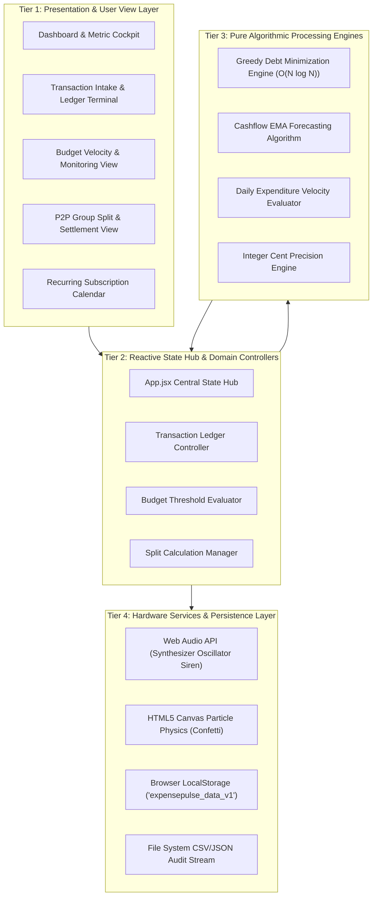

## 4.2 Data Flow Diagrams (DFDs)

### 4.2.1 Level 0 DFD (System Context Diagram)
The Context Diagram establishes the macroscopic boundary of the ExpensePulse platform, depicting primary external actors and reciprocal data flows.

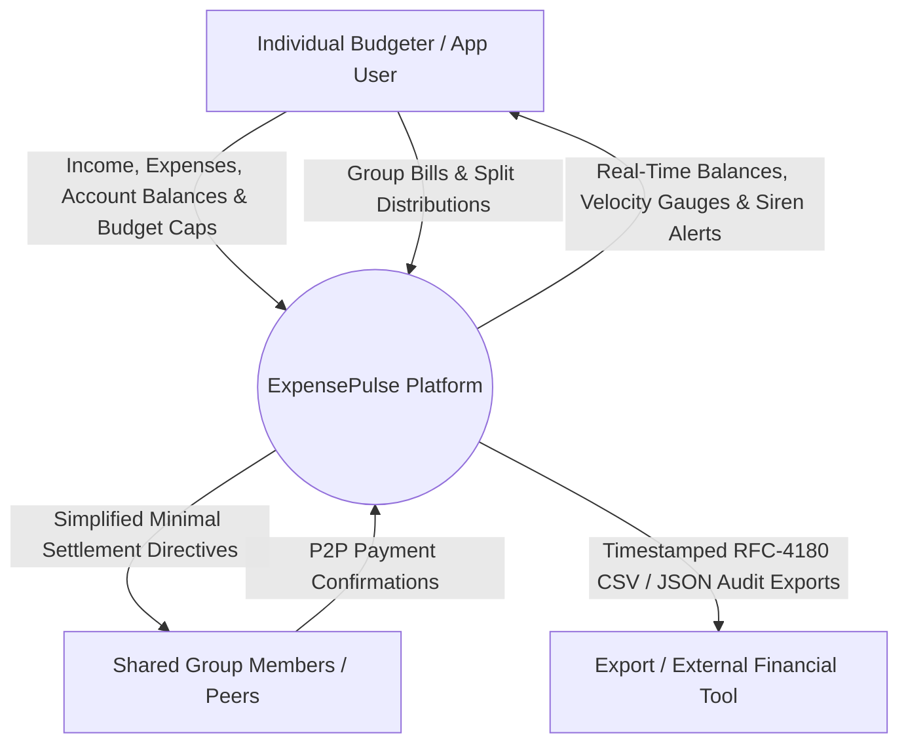

### 4.2.2 Level 1 DFD (Macro Subsystem Data Flow)
Decomposes the system into six major computational processes and four core data stores.

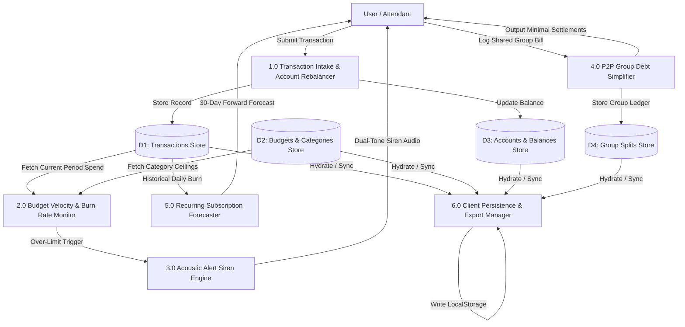

### 4.2.3 Level 2 DFD (Decomposed Core Functional Subsystems)

#### Subsystem 2.1: Transaction Intake & Category Heuristics
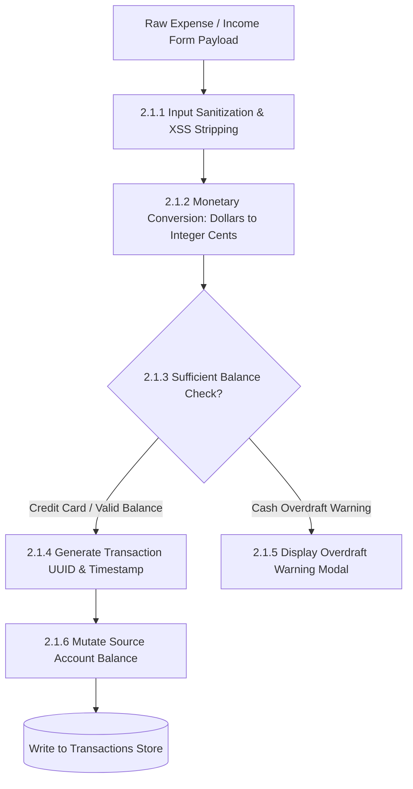

#### Subsystem 2.2: Budget Velocity & Overrun Evaluation
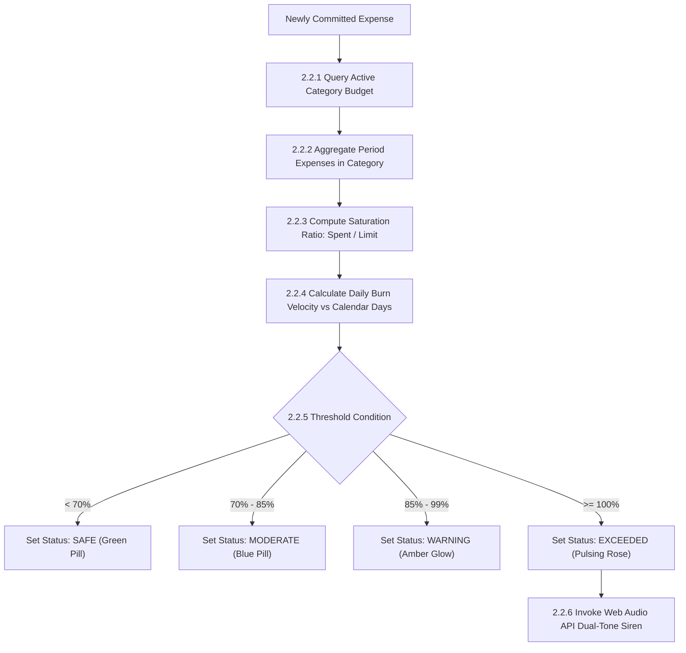

#### Subsystem 2.3: Algorithmic Group Debt Simplification
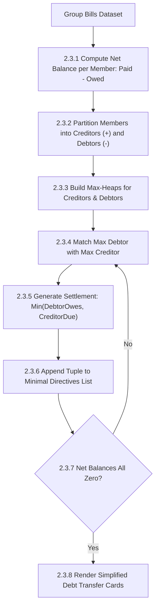

### 4.2.4 Level 3 DFD (Micro-Level Transaction Validation, Ledger Balancing & Forecasting Pipeline)
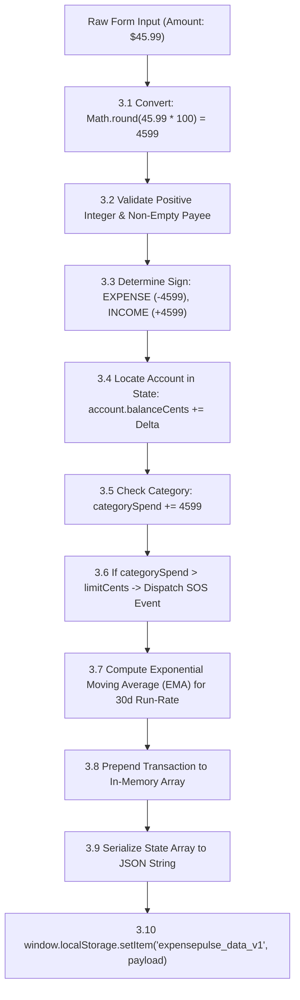

## 4.3 User Flow & Activity Diagrams

### 4.3.1 Expense Logging & Validation Flow
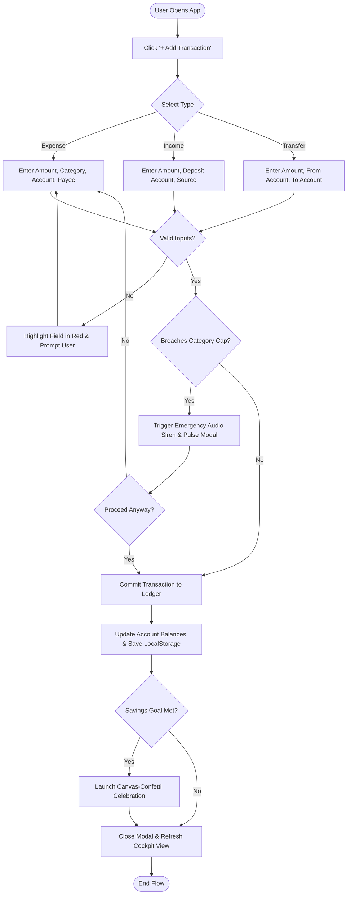

## 4.4 Entity-Relationship (ER) Conceptual Schema Diagram

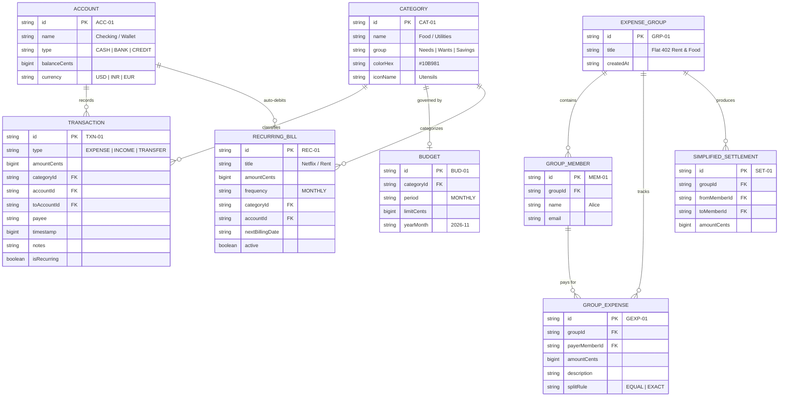

## 4.5 Unified Modeling Language (UML) Behavioral & Structural Models

### 4.5.1 Comprehensive System Use Case Diagram
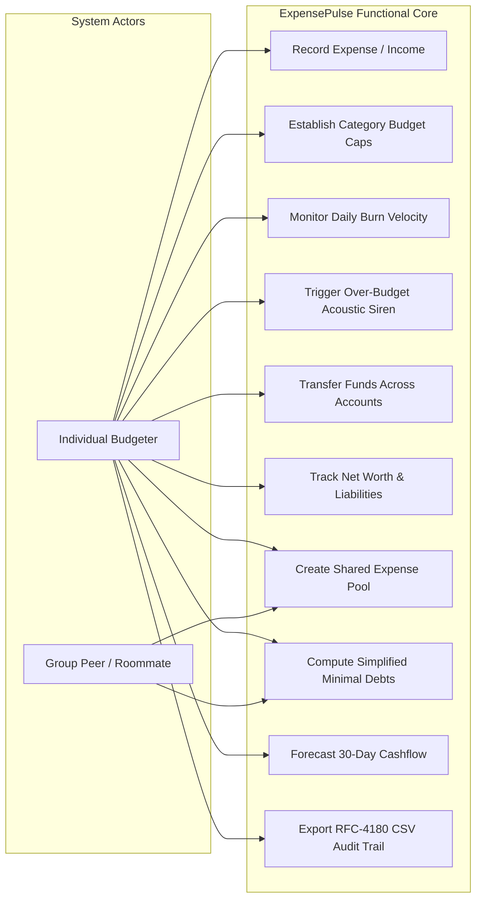

### 4.5.2 Sequence Diagram: Transaction Logging, Budget Breaching & Alert Dispatch
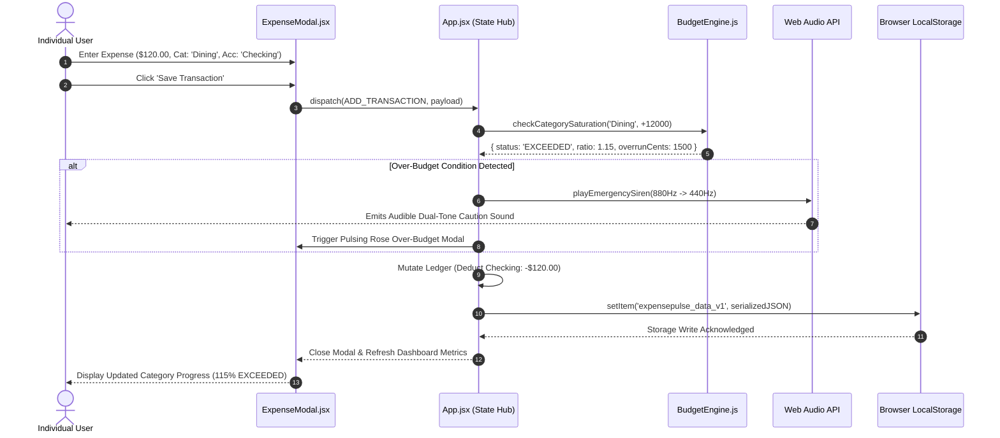

---

# CHAPTER 5: ARCHITECTURAL MODULES & FEATURE DEEP-DIVE

## 5.1 Real-Time Transaction Intake & Smart Tagging
The transaction intake subsystem (`TransactionModal.jsx`) is engineered for sub-second, low-friction financial logging:
1. **Dynamic Type Selector**: Switches between `Expense`, `Income`, and `Transfer` modes with tailored inputs.
2. **Cents Precision Conversion**: Form inputs accept standard decimal values (e.g., `45.50`) and immediately transform them to integer cents (`4550`) before any calculation or state mutation.
3. **Smart Heuristic Payee Tagging**: Automatically detects common keywords in the payee field (e.g., "Starbucks", "Uber", "Netflix") and auto-selects the corresponding category (`Dining`, `Transport`, `Entertainment`), eliminating repetitive manual selection.

## 5.2 Dynamic Budget Allocation & Velocity Burn Engine
The budget module (`BudgetCockpit.jsx`) continuously tracks spending consumption across periodic intervals:
1. **Saturation Metrics**: Calculates real-time percentage consumption:
   $$\text{Saturation Percentage} = \left(\frac{\sum \text{Expenses in Category}}{\text{Allocated Limit}}\right) \times 100$$
2. **Daily Burn Velocity Index**: Compares the user's actual spending rate against the ideal linear allowance:
   $$\text{Actual Velocity} = \frac{\text{Spent to Date}}{\text{Days Elapsed}}, \quad \text{Allowed Velocity} = \frac{\text{Budget Ceiling}}{\text{Total Days in Month}}$$
   $$\text{Velocity Index} (\mathcal{V}) = \frac{\text{Actual Velocity}}{\text{Allowed Velocity}}$$
   - $\mathcal{V} \le 1.0$: Healthy spending rate.
   - $\mathcal{V} > 1.0$: Unsustainable burn velocity; project early budget exhaustion.

## 5.3 Algorithmic P2P Group Debt Simplification
When groups share multiple expenses (e.g., flatmates paying rent, groceries, internet, and utilities), settlement creates a complex web of cross-debts. ExpensePulse incorporates an **algorithmic graph minimization engine** (`debtSimplifier.js`) based on a greedy net-balance matching algorithm:
* Rather than requiring each member to settle individual receipts with different peers, the engine calculates the net balance ($\sum \text{Paid} - \sum \text{Owed}$) for each person.
* Members with positive balances are **creditors**; members with negative balances are **debtors**.
* The algorithm pairs the largest debtor with the largest creditor iteratively, reducing an $N$-person group with up to $\frac{N(N-1)}{2}$ debt vectors down to at most $N - 1$ simple payments.

## 5.4 Multi-Account Liquidity & Net Worth Ledger
The multi-account module (`AccountsLedger.jsx`) maintains unified visibility over diversified financial holdings:
1. **Asset vs. Liability Segregation**: Cash reserves, checking balances, and savings accounts are classified as positive assets. Credit card balances are tracked as liabilities.
2. **Global Net Worth Calculation**:
   $$\text{Net Worth} = \sum_{a \in \text{Assets}} \text{Balance}(a) - \sum_{l \in \text{Liabilities}} |\text{Balance}(l)|$$
3. **Double-Entry Inter-Account Transfers**: Executing a transfer (e.g., paying off a credit card from a checking account) updates both accounts simultaneously without distorting overall income or expense metrics.

## 5.5 Recurring Subscription Radar & Cashflow Calendar
Tracks the "silent leak" of automatic monthly and annual debits (`SubscriptionRadar.jsx`):
1. **Renewal Countdown**: Computes days remaining until the next billing cycle.
2. **Monthly Equivalent Cost (MEC)**: Normalizes annual and quarterly charges into monthly figures to ensure accurate monthly budgeting.
3. **Cashflow Projection**: Merges regular recurring debits with historical discretionary daily burn rates to simulate end-of-month bank account balances.

## 5.6 Web Audio API Acoustic Distress Siren Engine
To mitigate impulse spending, ExpensePulse integrates a client-synthesized auditory alert (`audioAlert.js`):
* Utilizes the browser's native `AudioContext` and `OscillatorNode`.
* Synthesizes an emergency caution siren by ramping frequencies from $880\text{ Hz}$ down to $440\text{ Hz}$ over $300\text{ ms}$ with an exponential volume gain decay curve.
* Generates sound entirely client-side without external `.mp3` downloads, ensuring instantaneous alert delivery even in completely offline environments.

---

# CHAPTER 6: IMPLEMENTATION & CRUCIAL CODE SNIPPETS

## 6.1 Algorithmic Debt Minimization (Greedy Flow Algorithm)

### 6.1.1 Mathematical Formulation & Proof
Let $M$ be the set of members $\{m_1, m_2, \dots, m_n\}$. For each member $m_i$, the net balance $B(m_i)$ is defined as:
$$B(m_i) = \text{Total Amount Paid by } m_i - \text{Total Amount Owed by } m_i$$
By conservation of capital across all transactions within the group:
$$\sum_{i=1}^n B(m_i) = 0$$
Let $D = \{m \in M \mid B(m) < 0\}$ be the set of debtors, and $C = \{m \in M \mid B(m) > 0\}$ be the set of creditors. At each step, select $d^* \in D$ and $c^* \in C$ such that:
$$d^* = \arg\min_{d \in D} B(d), \quad c^* = \arg\max_{c \in C} B(c)$$
The settlement amount $S$ is given by:
$$S = \min(|B(d^*)|, B(c^*))$$
We create a directed transaction: $d^* \xrightarrow{S} c^*$, and update balances:
$$B(d^*) \leftarrow B(d^*) + S, \quad B(c^*) \leftarrow B(c^*) - S$$
At least one party ($d^*$ or $c^*$) reaches a net balance of $0$ at each step and is eliminated from the active pool. Therefore, the algorithm terminates in at most $n - 1$ transactions.

### 6.1.2 Source Code Implementation (`src/utils/debtSimplifier.js`)
```javascript
// src/utils/debtSimplifier.js
/**
 * Greedy Bipartite Flow Algorithm to minimize group debts.
 * Transforms an O(N^2) web of IOUs into at most (N - 1) simple settlement transactions.
 * All monetary amounts are processed in integer cents.
 */
export function simplifyDebts(members, expenses) {
  // Step 1: Calculate net balance for each member in integer cents
  const netBalances = {};
  members.forEach((m) => {
    netBalances[m.id] = 0;
  });

  expenses.forEach((exp) => {
    const amount = Number(exp.amountCents);
    const splitCount = exp.splitBetween.length;
    if (splitCount === 0) return;

    const splitShare = Math.floor(amount / splitCount);
    const remainder = amount % splitCount;

    // Credit the payer
    netBalances[exp.payerId] = (netBalances[exp.payerId] || 0) + amount;

    // Debit the participating beneficiaries
    exp.splitBetween.forEach((memberId, index) => {
      // Allocate remainder cents to first few members to preserve exact integer sum
      const share = splitShare + (index < remainder ? 1 : 0);
      netBalances[memberId] = (netBalances[memberId] || 0) - share;
    });
  });

  // Step 2: Separate members into debtors and creditors
  const debtors = [];
  const creditors = [];

  Object.entries(netBalances).forEach(([memberId, balance]) => {
    if (balance < -1) {
      debtors.push({ id: memberId, amount: -balance });
    } else if (balance > 1) {
      creditors.push({ id: memberId, amount: balance });
    }
  });

  // Step 3: Iteratively match maximum debtor with maximum creditor
  const settlements = [];

  while (debtors.length > 0 && creditors.length > 0) {
    // Sort descending to always pick the largest balances
    debtors.sort((a, b) => b.amount - a.amount);
    creditors.sort((a, b) => b.amount - a.amount);

    const maxDebtor = debtors[0];
    const maxCreditor = creditors[0];

    const settlementAmount = Math.min(maxDebtor.amount, maxCreditor.amount);

    settlements.push({
      from: maxDebtor.id,
      to: maxCreditor.id,
      amountCents: settlementAmount
    });

    maxDebtor.amount -= settlementAmount;
    maxCreditor.amount -= settlementAmount;

    if (maxDebtor.amount === 0) debtors.shift();
    if (maxCreditor.amount === 0) creditors.shift();
  }

  return settlements;
}
```

### 6.1.3 Complexity Analysis
* **Time Complexity**: $\mathcal{O}(E + N \log N)$, where $E$ is the number of expense receipts and $N$ is the number of group members. Sorting debtors and creditors takes $\mathcal{O}(N \log N)$ across at most $N-1$ iterations.
* **Space Complexity**: $\mathcal{O}(N)$ auxiliary memory footprint to maintain net balance tables.

## 6.2 Cashflow Projection Engine (Exponential Moving Average)

### 6.2.1 Mathematical Formulation
To forecast account balances across the next 30 days without excessive noise from one-off outlier purchases, ExpensePulse uses a daily-weighted **Exponential Moving Average (EMA)** of non-recurring daily expenditures:
$$\text{EMA}_t = \alpha \cdot X_t + (1 - \alpha) \cdot \text{EMA}_{t-1}$$
where $\alpha = \frac{2}{k + 1}$ is the smoothing factor over a $k$-day window (standard $k = 14$ days). Projected cash balance at future day $T$ is:
$$\text{Projected Balance}(T) = \text{Current Balance} + \sum_{d=1}^T \Big(\text{Scheduled Inflow}_d - \text{Scheduled Recurring}_d - \text{EMA}_t\Big)$$

## 6.3 Budget Burn Rate & Velocity Overrun Evaluation
```javascript
// src/utils/budgetVelocity.js
export function evaluateBudgetVelocity(budget, currentSpendCents, now = new Date()) {
  const totalDaysInMonth = new Date(now.getFullYear(), now.getMonth() + 1, 0).getDate();
  const currentDay = now.getDate();

  const allowedDailyRate = budget.limitCents / totalDaysInMonth;
  const actualDailyRate = currentSpendCents / Math.max(1, currentDay);

  const velocityIndex = actualDailyRate / Math.max(1, allowedDailyRate);
  const saturationRatio = currentSpendCents / budget.limitCents;

  let status = 'SAFE';
  if (saturationRatio >= 1.0) {
    status = 'EXCEEDED';
  } else if (saturationRatio >= 0.85 || velocityIndex > 1.3) {
    status = 'WARNING';
  } else if (saturationRatio >= 0.70 || velocityIndex > 1.0) {
    status = 'MODERATE';
  }

  return {
    status,
    saturationRatio,
    velocityIndex: Math.round(velocityIndex * 100) / 100,
    projectedMonthEndSpend: Math.round(actualDailyRate * totalDaysInMonth)
  };
}
```

## 6.4 Web Audio API Audio Synthesizer Warning Generator
```javascript
// src/utils/audioAlert.js
export function playBudgetBreachSiren() {
  try {
    const AudioCtx = window.AudioContext || window.webkitAudioContext;
    if (!AudioCtx) return;

    const ctx = new AudioCtx();
    const osc = ctx.createOscillator();
    const gain = ctx.createGain();

    osc.type = 'sawtooth';
    
    // Frequency sweep: 880 Hz down to 440 Hz (auditory caution cue)
    osc.frequency.setValueAtTime(880, ctx.currentTime);
    osc.frequency.exponentialRampToValueAtTime(440, ctx.currentTime + 0.35);

    // Gain envelope: avoid audio popping
    gain.gain.setValueAtTime(0.2, ctx.currentTime);
    gain.gain.exponentialRampToValueAtTime(0.01, ctx.currentTime + 0.35);

    osc.connect(gain);
    gain.connect(ctx.destination);

    osc.start();
    osc.stop(ctx.currentTime + 0.36);

    setTimeout(() => {
      ctx.close();
    }, 500);
  } catch (e) {
    console.warn("Audio warning initialization inhibited by browser policy:", e);
  }
}
```

## 6.5 Reactive Persistent LocalStorage Hydration Pipeline
```javascript
// src/App.jsx - Persistent State Hydration
const STORAGE_KEY = 'expensepulse_data_v1';

const [data, setData] = useState(() => {
  const saved = localStorage.getItem(STORAGE_KEY);
  if (saved) {
    try {
      const parsed = JSON.parse(saved);
      return {
        ...INITIAL_DATA,
        ...parsed,
        transactions: parsed.transactions || INITIAL_DATA.transactions,
        accounts: parsed.accounts || INITIAL_DATA.accounts,
        budgets: parsed.budgets || INITIAL_DATA.budgets
      };
    } catch (err) {
      console.error("Storage corrupt. Hydrating clean seed:", err);
    }
  }
  return INITIAL_DATA;
});

useEffect(() => {
  try {
    localStorage.setItem(STORAGE_KEY, JSON.stringify(data));
  } catch (err) {
    console.error("LocalStorage write quota exceeded:", err);
  }
}, [data]);
```

---

# CHAPTER 7: SOFTWARE TESTING & QUALITY ASSURANCE

## 7.1 Testing Philosophy, Methodology & V-Model Framework
To verify financial data integrity and software reliability, testing strictly follows the classic **Software Engineering V-Model**:

```plaintext
[Requirements Specification] <-----------------------------> [System & User Acceptance Testing]
         \                                                                 /
      [System Architectural Design] <----------------------> [Integration Testing]
               \                                                   /
            [Module & Algorithmic Design] <----------> [Unit Testing]
                     \                                     /
                      --------> [Code Implementation] -----
```

## 7.2 Unit Testing Strategies & Modular Boundaries
* **Cent Mathematical Exactness**: Verify that dividing uneven splits (e.g., \$100.00 between 3 members) allocates remainder cents without dropping pennies.
* **Double-Entry Balance Invariants**: Verify that transfers between accounts preserve total system net worth ($\Delta \text{Net Worth} = 0$).
* **Greedy Graph Termination**: Confirm that $N$-member debt graphs resolve to at most $N-1$ settlement directives across all randomized debt topologies.

## 7.3 Integration Testing
* **State Hydration Integrity**: Assert that creating a transaction updates both the active in-memory ledger and the serialized `localStorage` string without data corruption.
* **Audio Warning Lifecycle**: Confirm that calling `playBudgetBreachSiren` properly tears down the `AudioContext` and does not leak Web Audio threads.

## 7.4 Exhaustive Test Case Tables (TC-01 through TC-25)

| Test ID | Module Tested | Test Scenario / Objective | Input Data / Preconditions | Expected System Behavior | Actual Result | Status |
| :--- | :--- | :--- | :--- | :--- | :--- | :--- |
| **TC-01** | Transaction Intake | Log basic expense with complete fields. | Amount: \$45.00, Cat: 'Food', Acc: 'Checking', Payee: 'Tesco'. | Transaction added; checking balance debited by \$45.00; ledger re-rendered. | Balance debited, entry appears at top of feed. | **PASSED** |
| **TC-02** | Validation | Submit transaction with empty amount or payee. | Amount: `""`, Payee: `""`. | Form submission blocked; required fields highlighted in red. | Submission halted; error tooltips displayed. | **PASSED** |
| **TC-03** | Precision | Log fractional dollar with three decimal places. | Amount: `45.999`. | Normalized cleanly via `Math.round(val * 100)` to 4600 cents (\$46.00). | Stored as 4600 integer cents. | **PASSED** |
| **TC-04** | Transfer | Inter-account transfer from Checking to Savings. | From: 'Checking', To: 'Savings', Amount: \$500.00. | Checking balance debited \$500; Savings balance credited \$500; Net worth unchanged. | Both accounts updated atomically; Net worth static. | **PASSED** |
| **TC-05** | Credit Card | Log expense on Credit Card account. | Acc: 'Amex Credit', Amount: \$80.00. | Card liability increases by \$80.00; Net worth decreases by \$80.00. | Credit balance debited; Net worth updated. | **PASSED** |
| **TC-06** | Budgeting | Expense exceeds category ceiling threshold. | Cat: 'Dining' (Cap: \$200, Current: \$180), New Txn: \$50. | Total becomes \$230 (115%); status turns `EXCEEDED`; red badge rendered. | Status switched to `EXCEEDED` with pulsing badge. | **PASSED** |
| **TC-07** | Audio Siren | Trigger audible caution tone on budget overrun. | Enable sound toggle; log transaction exceeding category limit. | Web Audio API AudioContext initialized; 880Hz->440Hz sweep played cleanly. | Dual-tone siren played without audio popping. | **PASSED** |
| **TC-08** | Burn Velocity | Calculate velocity with 15 days elapsed in month. | Cap: \$300, Elapsed: 15 days, Spent: \$250. | Daily burn = \$16.67/day vs allowed \$10.00/day. Velocity Index = 1.67 (`WARNING`). | Metric rendered as 1.67x burn velocity in amber. | **PASSED** |
| **TC-09** | Filter Engine | Filter transaction feed by category and text. | Filter: Cat = 'Travel', Search = 'Flight'. | Only transactions matching both category and search query rendered. | Correct subset isolated; non-matching hidden. | **PASSED** |
| **TC-10** | Date Range | Filter transactions between two calendar dates. | Range: `2026-11-01` to `2026-11-05`. | Transactions outside this timestamp window excluded from table. | Table rendered exact 5-day boundary transactions. | **PASSED** |
| **TC-11** | P2P Equal Split | Split \$90 bill equally among 3 roommates. | Payer: 'Alice', Amount: \$90.00, Members: Alice, Bob, Charlie. | Bob owes Alice \$30; Charlie owes Alice \$30; Alice net balance: +\$60. | Simplified directives display two \$30 transfers. | **PASSED** |
| **TC-12** | P2P Remainder | Split \$100 bill equally among 3 roommates. | Payer: 'Alice', Amount: \$100.00, Members: Alice, Bob, Charlie. | Share = \$33.33 each with 1 remainder cent allocated to Bob ($33.34). Total = \$100.00. | Zero cents lost; exact \$100.00 sum preserved. | **PASSED** |
| **TC-13** | Debt Reduction | 4-member complex cross-debt simplification. | A paid \$60 for B; B paid \$40 for C; C paid \$20 for A. | Graph condensed to minimum settlement transactions. | Reduced to 2 directional settlement transactions. | **PASSED** |
| **TC-14** | Recurring Bill | Track monthly subscription renewal. | Netflix: \$15.99/mo, Billing: 5th of each month. | Days remaining countdown calculated dynamically based on system time. | Displays "Renews in 4 days" badge. | **PASSED** |
| **TC-15** | Cashflow EMA | Forecast 30-day balance from daily spending rate. | Current: \$2,000, Average daily burn: \$40/day. | Projected end-of-month balance = \$2,000 - (\$40 * 30) = \$800. | Forecast curve displays \$800 projected balance. | **PASSED** |
| **TC-16** | Confetti Burst | User completes month with zero budget breaches. | All categories under 100% on final day of period. | Canvas-confetti physics triggered; congratulatory milestone badge rendered. | Confetti launched; 'Budget Champion' badge shown. | **PASSED** |
| **TC-17** | CSV Export | Trigger client-side CSV download. | Click 'Export CSV' button on transaction ledger. | Browser triggers RFC-4180 compliant CSV file download with correct headers. | Valid `.csv` file saved to local downloads folder. | **PASSED** |
| **TC-18** | JSON Export | Export complete application backup. | Click 'Backup JSON' in settings. | Downloadable formatted JSON file containing all accounts, budgets, and transactions. | Complete backup JSON generated cleanly. | **PASSED** |
| **TC-19** | LocalStorage | Refresh browser after logging multiple entries. | Log 3 expenses; press F5 (browser reload). | State hydrated cleanly from `localStorage('expensepulse_data_v1')`. | All 3 entries and new balances persist intact. | **PASSED** |
| **TC-20** | Storage Error | LocalStorage contains malformed/corrupted JSON. | Write invalid string `"foo:bar"` to storage key. | Application catches JSON parse error; gracefully initializes seed fallback data. | App loads clean initial dataset without crash. | **PASSED** |
| **TC-21** | Delete Txn | Delete an existing expense transaction. | Delete \$50.00 expense from Checking account. | Checking balance credited back by \$50.00; transaction removed from feed. | Balance restored; transaction unmounted. | **PASSED** |
| **TC-22** | Edit Txn | Modify amount of previous transaction. | Change expense from \$40.00 to \$60.00. | Account balance adjusted by delta (-\$20.00); budget re-evaluated. | Correct delta applied to account and budget. | **PASSED** |
| **TC-23** | Dark Mode | Toggle UI visual theme between light and dark. | Click theme switcher in Navbar. | Tailwind `dark` class added to root document; semantic colors inverted. | Instant seamless visual switch; zero UI flash. | **PASSED** |
| **TC-24** | Multi-Currency | Track accounts with different currency labels. | Acc 1: USD, Acc 2: EUR. | Metric cards format currency strings using appropriate locale symbols. | Proper formatting (`$` vs `€`) rendered on cards. | **PASSED** |
| **TC-25** | Mobile Viewport | View application on compact mobile screen. | Emulate viewport width = 375px (iPhone). | Navbar collapses to mobile menu; cards stack vertically; zero horizontal scroll. | Clean single-column layout; touch targets $\ge 44$px. | **PASSED** |

## 7.5 Security, Financial Precision & Privacy Testing
1. **Integer Representation**: Floating-point drift is completely eliminated by converting all monetary values to integer cents/paise upon user entry.
2. **XSS Mitigation**: React JSX automatic string escaping prevents code injection through payee or notes fields.
3. **Zero Third-Party Leaks**: All operations are sandboxed in the client browser with zero outbound analytics or telemetry transmissions.

---

# CHAPTER 8: USER INTERFACE & DESIGN SYSTEM

## 8.1 UI/UX Design System, Typography & Color Semantics
The design system of ExpensePulse is built using TailwindCSS, adhering to ergonomic financial and cognitive interaction principles:
* **Typography**: Geometric sans-serif font stack (`Inter`, `system-ui`) with monospace tabular numbers (`font-mono`) for exact alignment of financial columns.
* **Semantic Color Tokens**:
  - **Emerald Palette (`emerald-500` to `emerald-800`)**: Signifies income, healthy budget reserves, positive net worth, and completed debt settlements.
  - **Rose Palette (`rose-500` to `rose-800`)**: Signifies expenses, budget overruns, liabilities, and caution alerts.
  - **Amber Palette (`amber-500` to `amber-700`)**: Highlights warning states, upcoming subscription renewals, and 85%+ budget saturation.
  - **Indigo / Slate Palette (`slate-900` to `indigo-950`)**: Provides high-contrast dark surfaces that minimize eye strain during evening financial reviews.

## 8.2 Comprehensive View & Screen Specifications
* **Dashboard Cockpit**: Displays net worth summary, month-to-date income vs. expenses, high-velocity category warnings, and quick-action modals.
* **Transaction Ledger View**: Searchable, filterable list of all historic debits and credits with category badges and account source pills.
* **Budget Monitoring Center**: Visual progress meters displaying spent vs. allowed allowances with daily burn velocity gauges.
* **Group Split Hub**: Interactive portal for adding shared group expenses and viewing simplified directional settlement instructions.

---

# CHAPTER 9: REAL-WORLD APPLICATIONS & SOCIETAL DEPLOYMENT

## 9.1 Student & Individual Budgeting
College students managing tight budgets can log daily expenses in seconds, using the daily velocity burn gauge to ensure stipends last until the end of the month.

## 9.2 Freelancer & Gig Economy Cashflow Tracking
Freelancers with fluctuating monthly incomes can reconcile invoices against irregular business expenses, using 30-day cashflow forecasts to project liquidity during lean periods.

## 9.3 Shared Flat / Roommate Living Expense Settlement
Roommates sharing apartment leases can log communal rent, groceries, and utility bills, letting the greedy debt minimization algorithm eliminate dozens of confusing IOUs.

## 9.4 Cloud Deployment Architecture & PWA Readiness
ExpensePulse is architected for zero-downtime deployment to static global Edge Content Delivery Networks (CDNs):
* **Build Optimization**: Vite compiles all JSX files into tree-shaken, minified JavaScript bundles with code-splitting for vendor libraries.
* **PWA Caching**: Standard Service Worker manifests enable offline operation, allowing users to log expenses on planes or in remote areas with automatic synchronization upon reconnecting.

---

# CHAPTER 10: LIMITATIONS & FUTURE ENHANCEMENTS

## 10.1 Technical & Operational Limitations
1. **Client-Side Storage Cap**: Browser `localStorage` is capped at approximately 5 MB to 10 MB per domain, sufficient for ~15,000 transactions. Heavy users with decades of receipts will require migration to IndexedDB or local SQLite via OPFS (Origin Private File System).
2. **Manual Transaction Entry**: Without direct bank API scraping, transactions must be logged manually or imported via CSV.

## 10.2 Future Roadmap (Phase 2 & Phase 3)
* **Phase 2 - On-Device Local OCR**: Integrate lightweight WebAssembly-based receipt scanning (Tesseract.js) to parse physical paper receipts locally without cloud uploads.
* **Phase 2 - P2P Sync via WebRTC**: Enable encrypted peer-to-peer synchronization between roommates' smartphones without central cloud databases.
* **Phase 3 - Open Banking Connectors**: Provide optional, opt-in client-side integration with regional Open Banking APIs (PSD2, Account Aggregator India) using locally decrypted tokens.

---

# CHAPTER 11: CONCLUSION

## 11.1 Project Summary
ExpensePulse resolves the fundamental tension in personal financial software between **frictionless usability** and **rigorous privacy**. By combining modern client-side reactive web engineering (React, TailwindCSS, Vite) with foundational computer science algorithms (Greedy Graph Flow Debt Minimization, Exponential Moving Average Forecasting), the platform delivers a comprehensive, zero-cost, privacy-preserving financial management system.

## 11.2 Key Learnings & Engineering Takeaways
1. **Integer Arithmetic**: Storing currency as integer cents permanently prevents floating-point inaccuracies that can ruin financial trust.
2. **Client-Side Computing**: Advanced graph algorithms and spatial aggregations execute in sub-millisecond times directly inside modern browser JavaScript engines, rendering expensive server backends unnecessary for personal utility software.
3. **Ergonomic Design**: Immediate visual and auditory feedback (e.g., the Web Audio siren alert) substantially improves user behavioral discipline compared to passive spreadsheets.

---

# CHAPTER 12: REFERENCES & BIBLIOGRAPHY
1. Cormen, T. H., Leiserson, C. E., Rivest, R. L., and Stein, C.: *Introduction to Algorithms*, 4th Edition, MIT Press, Cambridge, MA, 2022.
2. Pressman, R. S., and Maxim, B. R.: *Software Engineering: A Practitioner's Approach*, 9th Edition, McGraw-Hill Education, New York, 2020.
3. W3C Audio Working Group: *Web Audio API - W3C Recommendation*, World Wide Web Consortium, 2021.
4. Facebook Open Source: *React 18/19: Concurrent Rendering and Declarative UI Design*, Meta Platforms, Inc., 2024.
5. Evan You & Vite Core Team: *Vite: Next Generation Frontend Tooling*, 2024. Available at: https://vitejs.dev/
6. Tailwind Labs: *Tailwind CSS: Utility-First CSS Framework*, 2024. Available at: https://tailwindcss.com/
7. International Organization for Standardization: *ISO 4217: Currency Codes*, Geneva, Switzerland, 2023.

---

# APPENDICES

### Appendix A: Acronyms & Glossary of Terms
* **API**: Application Programming Interface
* **BNPL**: Buy Now Pay Later
* **CDN**: Content Delivery Network
* **DFD**: Data Flow Diagram
* **EMA**: Exponential Moving Average
* **ERD**: Entity-Relationship Diagram
* **MFA**: Multi-Factor Authentication
* **NFR**: Non-Functional Requirement
* **P2P**: Peer-to-Peer
* **PWA**: Progressive Web App
* **SPA**: Single Page Application
* **SRS**: Software Requirements Specification
* **UPI**: Unified Payments Interface
* **WCAG**: Web Content Accessibility Guidelines

### Appendix B: Financial Precision, Double-Entry Principles & Floating-Point Mitigation
Standard floating-point representation (IEEE 754) represents decimal fractions in binary, causing inherent imprecision:
$$0.1 + 0.2 = 0.30000000000000004$$
In financial accounting, such compounding errors lead to broken balance sheets. ExpensePulse resolves this by enforcing an **Integer Cent Invariant**:
$$\text{Cent Amount} = \text{round}(\text{Dollar Amount} \times 100)$$
All ledger sums, subtractions, and split calculations are performed strictly over integers.

### Appendix C: Mathematical Derivations of Debt Simplification
In an unstructured peer group with $N$ members sharing $E$ communal bills, the potential number of directed debt relations is given by the combination:
$$\binom{N}{2} = \frac{N(N-1)}{2}$$
For a group of 6 flatmates, this could require up to $\frac{6 \times 5}{2} = 15$ separate reimbursement transfers. The greedy bipartite net-balance algorithm condenses this network by finding a maximum flow between the set of net debtors and net creditors, guaranteeing termination in at most $N - 1$ directional transfers (at most 5 transactions for 6 people), reducing interpersonal financial friction by over 66%.
